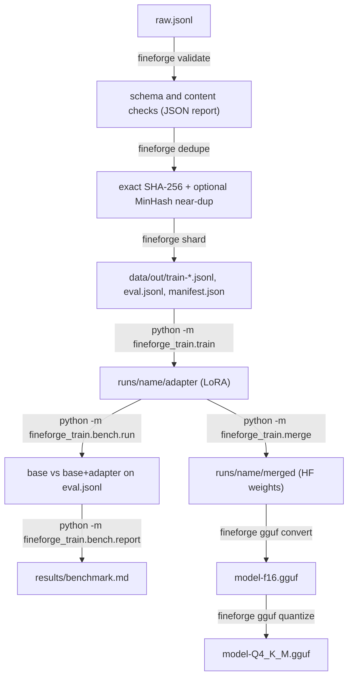

# FineForge

[](https://github.com/iboondk/fineforge/actions/workflows/ci.yml)

FineForge is a toolkit for preparing a JSONL dataset, fine-tuning a small language model with LoRA or QLoRA, and comparing the tuned model with its base.

- **`fineforge`** (Rust CLI): validates, dedupes and shards JSONL datasets, and wraps llama.cpp's GGUF convert and quantize steps.
- **`fineforge_train`** (Python): LoRA/QLoRA training, adapter merging, and a benchmark of base vs. tuned on an eval split.

> **Status:** the pipeline is implemented and its unit tests are in place. No benchmark has been run yet, so no results are claimed. See [`results/benchmark.md`](results/benchmark.md), which shows `TBD` until a real run produces numbers.

## Architecture



The Rust and Python halves share only the dataset contract and files on disk. Neither calls the other's code. The reasoning is in [ADR-0001](docs/ADR-0001-rust-cli-python-trainer.md).

## Dataset contract

Each line of a JSONL file is one of two shapes:

- **chat**: `{"messages": [{"role": "system" | "user" | "assistant", "content": "..."}, ...]}`. There must be at least two messages, at least one `user`, the last message must be `assistant`, and `system` may appear only at index 0.
- **instruction**: `{"instruction": "...", "input": "...", "output": "..."}`. `input` is optional. `instruction` and `output` must be non-empty strings.

Extra top-level keys such as `id` or `source` are kept as they are. The full contract is in [docs/dataset-format.md](docs/dataset-format.md).

## Quick start

### One command

```bash
make          # builds the CLI, runs all tests, then runs the sample pipeline (no GPU)
```

`make test` runs only the tests, and `make demo` runs only the pipeline on `data/sample/sample.jsonl`. Requires Rust (stable) and Python 3.10+.

### Docker

Not applicable. The project has no container image or `docker-compose.yml`. The Rust CLI is a plain binary, and training needs a GPU. The intended environment is a free Colab T4, which the notebook covers.

### 1. Build and test the CLI

Requires Rust (stable, edition 2021).

```bash
cd cli
cargo test
cargo build --release
./target/release/fineforge validate ../data/sample/sample.jsonl
```

### 2. Prepare a dataset

```bash
mkdir -p data/out
./cli/target/release/fineforge dedupe data/sample/sample.jsonl -o data/out/deduped.jsonl --near 0.8 --stats data/out/dedupe-stats.json
./cli/target/release/fineforge shard data/out/deduped.jsonl --out-dir data/out --shards 2 --eval-ratio 0.1 --seed 42
```

The same input and seed always produce byte-identical outputs.

### 3. Install the trainer and check the plan

The core install needs only `pyyaml`. The `dev` extra adds `pytest`. The `train` extra adds the GPU stack and is needed for a real run.

```bash
cd trainer
python3 -m venv .venv && . .venv/bin/activate
pip install -e ".[dev]"
python -m pytest -q
python -m fineforge_train.train --config configs/qlora.yaml --dry-run
```

`--dry-run` prints the plan as JSON and does not import torch. It needs the shards from step 2.

For a real run, install the GPU stack with `pip install -e ".[train]"` on a machine with CUDA, or follow the Colab notebook at [`notebooks/fineforge_colab.ipynb`](notebooks/fineforge_colab.ipynb).

### 4. Optional: GGUF

Requires a local llama.cpp checkout and `llama-quantize` on `PATH`. Dry-run prints the commands without running them.

```bash
export LLAMA_CPP_DIR=/path/to/llama.cpp
./cli/target/release/fineforge gguf convert path/to/merged --outfile model-f16.gguf --dry-run
./cli/target/release/fineforge gguf quantize model-f16.gguf model-Q4_K_M.gguf --type Q4_K_M --dry-run
```

### Secrets

Gated base models need a Hugging Face token. Copy `.env.example` to `.env` and set `HF_TOKEN` there. Never commit a real token. `.env` is not in the repository.

## Benchmark

`python -m fineforge_train.bench.run` scores the base model and the tuned model on an eval file. `python -m fineforge_train.bench.report --results results/results.json` renders [`results/benchmark.md`](results/benchmark.md). Without a results file, every cell reads `TBD`.

The target is an approximately 26% relative improvement. It has not been measured. Relative improvement is `(tuned - base) / base * 100`, and it is shown as `n/a` when the base is 0.

## Demo

[DEMO.md](DEMO.md) is a step-by-step script for recording a GIF or Loom of the pipeline.

## Write-up and decisions

- [WRITEUP.md](WRITEUP.md): the problem, the architecture, the key decisions, the current results and next steps.
- [docs/](docs/): architecture decision records (ADR-0001 to ADR-0005), the [dataset format](docs/dataset-format.md) and the [benchmark methodology](docs/benchmark-methodology.md).

## Repository layout

```
cli/                  Rust crate "fineforge" (validate, dedupe, shard, gguf)
trainer/              Python package "fineforge_train" (train, merge, bench)
data/sample/          Small synthetic sample dataset
scripts/              Sample-data generator and notebook builder, with tests
notebooks/            Generated Colab notebook
results/              Benchmark report (TBD until measured)
docs/                 ADRs, dataset format, benchmark methodology
.github/workflows/    CI: Rust tests and Python tests
```

## Testing

CI (`.github/workflows/ci.yml`) runs `cargo fmt --check`, `cargo clippy -D warnings` and `cargo test` for the CLI and `pytest` for the trainer and scripts. The trainer tests need no torch and no GPU.

## License

MIT. See [LICENSE](LICENSE). Copyright (c) 2026 iboondk.
